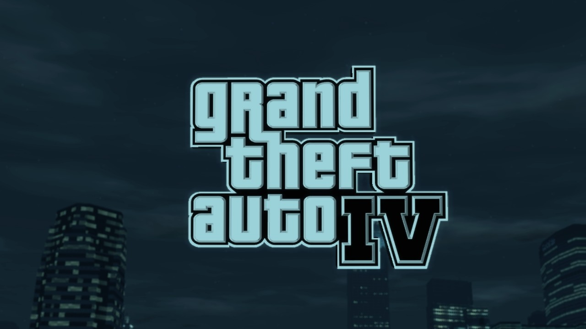
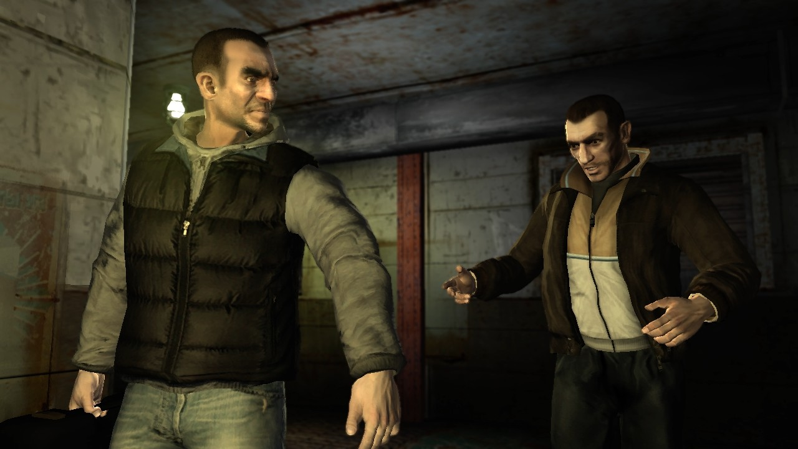
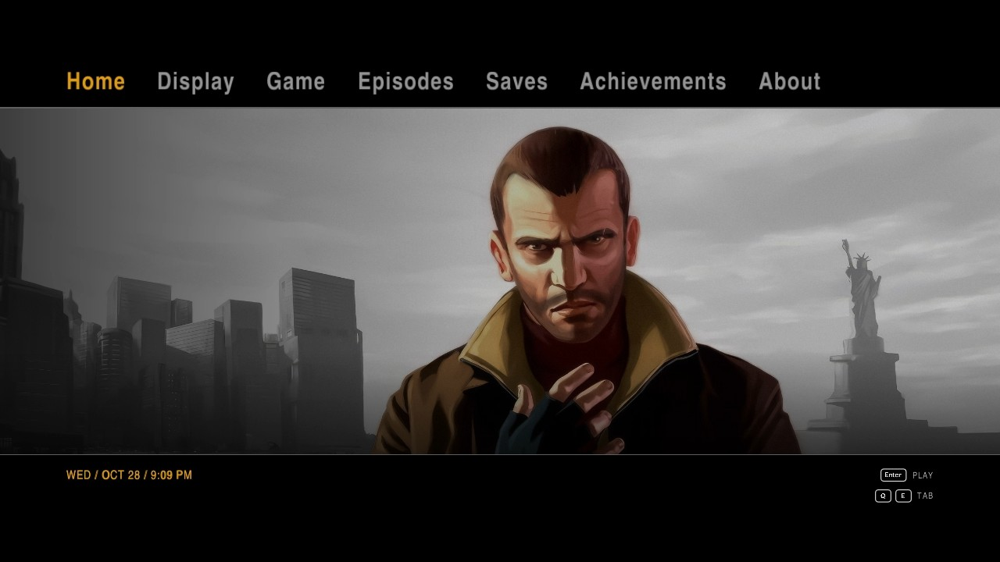
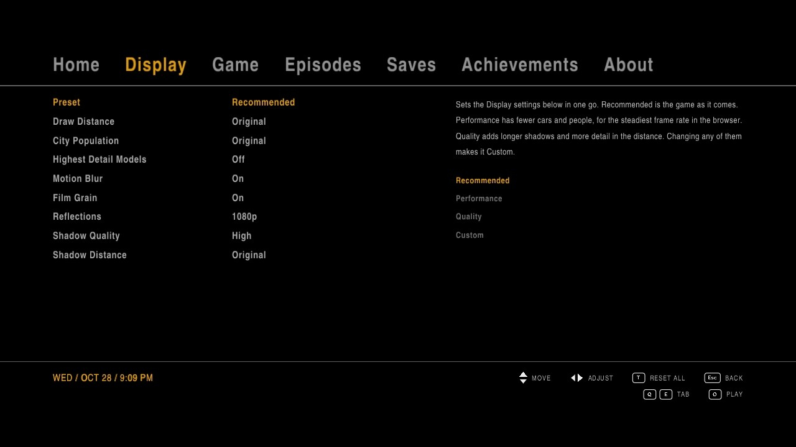
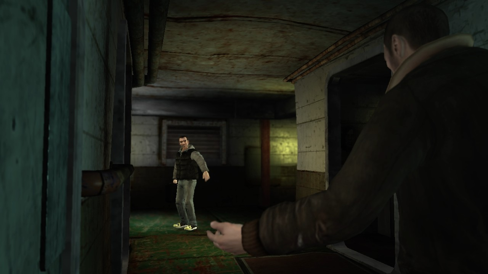
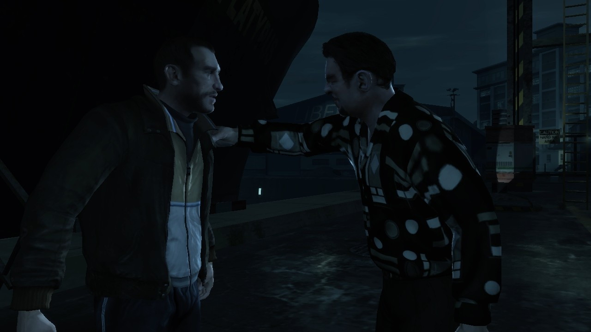
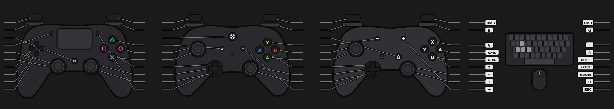

# GTA IV on the Web

**Grand Theft Auto IV (Xbox 360) running in a web browser**: the real game, recompiled to WebAssembly, drawn with WebGPU, played from your own copy of the disc.



> ### Built on Liberty Recompiled, LibertyRecompAndroid and the PS5 port
> This is the work of **[OZORDI](https://github.com/OZORDI)** ([Liberty Recompiled](https://github.com/OZORDI/LibertyRecomp), the native recompilation of GTA IV), **[vaduur](https://github.com/vaduur)** ([LibertyRecompAndroid](https://github.com/vaduur/LibertyRecompAndroid)) and **[elripalda](https://github.com/elripalda)** ([the PS5 port](https://github.com/elripalda/gta4-ps5) and its hub), with **[ReXGlue](https://github.com/rexglue/rexglue-sdk)** underneath. The web port by **[itzzace](https://github.com/itzzace)** takes all of that into the browser.
>
> Go star the original projects and support them.

## What's in it
- GTA IV running in Chrome, Edge or another Chromium browser, from WebAssembly (64-bit memory, threads) and WebGPU
- The game's own Xbox 360 shaders converted to WGSL, with the 360's display gamma, so it looks like the console: checked frame by frame against a recording of the Xbox 360
- Installs from your own disc image into the browser's storage once, then starts from there
- The PS5 port's hub in the browser: Home, Display, Game, Episodes, Saves, Achievements and About
- Keyboard and mouse, or a controller, with button prompts for PlayStation, Xbox 360, Xbox One / Series and Switch pads, and readable keyboard keycaps
- The pause menu's Controls page drawn for each controller, and for the keyboard on foot and in a vehicle
- Saves kept in your browser, with Download Saves, Load Saves From a File and Xbox 360 save import (each player picks their own files)
- A loading screen with install progress, a Fullscreen button and an FPS counter (F8)
- Play from a phone or tablet on your Wi-Fi, served from your own computer (experimental), with a device check page



## Screenshots
| | |
|---|---|
|  |  |
|  |  |

The pause menu's Controls page, redrawn for each controller and the keyboard:



## What you need
- An up-to-date **Chromium browser** (Chrome, Edge, Brave, Arc) with WebGPU, on a computer with about 8 GB of memory free for the page
- Your **own** copy of GTA IV for the **USA Xbox 360** as an `.iso`, and its **Title Update 8** (the same files as the [PS5 port](README-PS5.md#which-files-work)). **No game files are included.**
- About 8 GB free for the browser's copy of the install

Safari, Firefox and iPad / iPhone browsers don't have everything the game needs yet. Open `check.html` on a device to see what's missing there.

## Running it
The page is served by a small local server, which hands the browser your disc image, Title Update 8 and the RPF key straight from disk:

```bash
python3 -I web/scripts/serve.py web/build/link "/path/to/Grand Theft Auto IV (USA).iso" /path/to/TU_1A581VI_000000K000000.0000000000205 LibertyRecompLib/aes_key.bin 8765
```

(run from the repository's folder, after a build: see below)

Then open http://localhost:8765/ and the game installs itself into the browser the first time (a few minutes), and starts from there after that. `?log=1` shows the boot log, `?fps` the FPS counter.

To play from another device on your Wi-Fi, start it with `GTA4_WEB_LAN=1`: it serves HTTPS on your network, and http://&lt;your computer&gt;:8766/ hands the phone or tablet the certificate to trust (once).

## Building
The web build lives in [`web/`](web):
- [`web/scripts`](web/scripts): the page (`index.html`, `scene3d.js` for the 3D renderer, `webui.js` for the hub's overlays, `gameinput.js`), the server and the build scripts. Copy them into `web/build` and run them from there.
- [`web/shaders`](web/shaders): the tools that turn the game's shaders into WGSL.
- [`web/thirdparty`](web/thirdparty): the third-party libraries' Emscripten build (`web/build-tp`).
- The game-side changes are in `glue/rexglue-sdk-main` (search for `[web port]` and `__EMSCRIPTEN__`), most of them in `gta4-recomp/src/web/` and `src/graphics/web_frame_capture.cpp`.

You need [Emscripten](https://emscripten.org) (`EMSDK_DIR`, by default next to this repository), then `web/scripts/rebuild.sh` compiles the game code, the runtime and the glue and links `web/build/link/gta4.wasm`. The pause menu's controller pictures are rebuilt from your own game files with `tools/xtd_tools/build_controller_diagrams.py`, so they aren't stored here. The build is a work in progress and its steps are still rough.

The PS5 build, its hub and its packaging are as the PS5 port has them: see [README-PS5.md](README-PS5.md) and [ps5/BUILD.md](ps5/BUILD.md).

## Credits
- **[itzzace](https://github.com/itzzace)**: the web port: the WebAssembly and WebGPU build, the renderer, display gamma, controls, keyboard prompts, controller pictures, saves, loading screen and Wi-Fi play
- **[OZORDI](https://github.com/OZORDI)**: [Liberty Recompiled](https://github.com/OZORDI/LibertyRecomp), the GTA IV recompilation this is built on, with its contributors
- **[vaduur](https://github.com/vaduur)**: [LibertyRecompAndroid](https://github.com/vaduur/LibertyRecompAndroid), the fork the PS5 port starts from
- **[elripalda](https://github.com/elripalda)**: [the PS5 port](https://github.com/elripalda/gta4-ps5), the hub, the PlayStation buttons and the art
- **[ReXGlue](https://github.com/rexglue/rexglue-sdk)**: the static recompiler and runtime, which builds on [Xenia](https://github.com/xenia-project/xenia) and [XenonRecomp](https://github.com/hedge-dev/XenonRecomp)
- **[ThirteenAG](https://github.com/ThirteenAG)**: [FusionFix](https://github.com/ThirteenAG/GTAIV.EFLC.FusionFix), whose shaders and camera options the hub uses
- [Emscripten](https://emscripten.org), [naga](https://github.com/gfx-rs/wgpu/tree/trunk/naga), [SDL3](https://github.com/libsdl-org/SDL), [Dear ImGui](https://github.com/ocornut/imgui), [FFmpeg](https://ffmpeg.org), [stb](https://github.com/nothings/stb), [dr_libs](https://github.com/mackron/dr_libs), and the TeX Gyre Heros, Oswald and Inter fonts
- Everyone credited in the [PS5 port's README](README-PS5.md#credits)

## License
Liberty Recompiled, LibertyRecompAndroid, the PS5 port and this web port are under the [GPL-3.0](LICENSE). ReXGlue keeps its own BSD-style license ([glue/rexglue-sdk-main/LICENSE](glue/rexglue-sdk-main/LICENSE)), and the third-party libraries keep theirs. None of these cover the game, its artwork or its music.

*An unofficial fan project, not affiliated with or endorsed by Rockstar Games, Take-Two Interactive, Microsoft or Sony. Grand Theft Auto and all related names belong to their owners. No game files are included: you need your own copy of GTA IV for Xbox 360. The screenshots are of the game running in this port.*
